# Sixteen Wide — neural texture decoders for GPU matrix hardware

## Now

Proposal accepted with feedback "missing graphics novelty". Main contribution is now a **real-time decoder that feeds 4-bit block-scaled latents straight into Blackwell FP4 Tensor Cores** (STF makes this possible); the quantization experiments (`results/README.md`) become a "what matters" study, with **rendering-aware rounding** as a supporting technique. Compressor done; decoder v1 (FP16 MMA) matches PyTorch at 0.8–1.2 ms per 1080p frame; the 4-neighbour model, where **the four neighbouring latent texels map onto the four scale blocks of one FP4 MMA**, is being trained, then the FP4-direct kernel. Milestone is due **Sun 2026-11-22, 23:59 PT** (2 days); there are no late days.


| metric | target | now |
|---|---|---|
| Bistro frame time at 1920×1080 (ms) | real time (set number by milestone) | — |
| bits per texel, 9 channels (BC1+BC5+BC1 = 16) | lower at equal quality | 5.3 (MXFP4) / 5.7 (NVFP4), mid grid |
| PSNR after shading vs uncompressed (dB) | report per format | 32.5–33.9 MXFP4, texel loss; +1.8 dB with shading loss |
| FLIP after shading (mean) | lower with shading-aware quant. than texel loss | −15 % MXFP4, −23 % fp32 (shading loss alone) |
| decode time (µs per Mpixel) | FP4-direct vs FP16-unpack | 400–560 (v1, FP16 MMA, GPUs under load) |
| formats working end to end | 5 (MXINT8, MXFP8, MXFP6, MXFP4, NVFP4) | 5 in compressor, 0 in decoder |

### Open

Course deliverables (team includes 284A, so all CS284A rules apply):

- [ ] **Milestone — Sun 11/22 23:59 PT** → Gradescope "[Final Project] Milestone": PDF in ACM SIGGRAPH template, with clickable links to webpage, slides and video
- [ ] Milestone report (paper format, ~1 page of content): what's done, preliminary results, progress vs plan, updated plan — drafted in `paper/milestone.tex` (61f56d6); needs links, team read, push to Overleaf
- [ ] Milestone video: ~1 min, every member appears or speaks, unlisted YouTube or Berkeley-visible Drive
- [ ] Milestone slides: 2–3 slides, linked from the webpage
- [ ] Persistent project webpage (GitHub Pages) linking report, video, slides
- [ ] **Final — Sun 12/6 23:59 PT** → Gradescope "[Final Project] Final Deliverables": 4–6 page SIGGRAPH-format paper, focused on a novel technical contribution (40 % of the course grade)
- [ ] Final video: 1–2 min, every member appears or speaks (showcase uses only this)
- [ ] Final webpage: abstract, technical approach (incl. problems + lessons), results, references, per-member contributions, a showcase gif/clip
- [ ] Paper, video and slides must make clear: starting point (tiny-cuda-nn, NTC SDK, prior renderer) vs what we built
- [ ] **Presentation — Mon 12/7 or Tue 12/8**: 5 min hard (incl. 1 min demo) + 3 min Q&A; title slide marks each member 184/284
- [ ] Attend ≥ 8 other groups' talks (10 % of project grade); up to 20 for 5 % extra credit
- [ ] Peer review form, each member individually (date TBD on Ed; required to get a grade)
- [ ] Everyone commits under their own GitHub account (staff check contribution records)

Technical, by priority:

- [x] P0 compressor: latent grid + MLP, fake-quant for uniform 8/4-bit, MXINT8, MXFP8, MXFP6, MXFP4, NVFP4; QAT with straight-through estimator
- [x] P0 fit 3 Poly Haven materials, quality-vs-bits plot + side-by-side crops (milestone figure)
- [x] P1 shading-aware block scales: worse than the spec rule in 12/12 cases (negative result)
- [x] P1 rendering-aware rounding pilot: −3 to −10 % FLIP on 3 materials, beats texel-aware rounding on all
- [ ] P1 rounding robustness: 6 materials × 2 seeds × MXFP4/NVFP4 × texel/shading training, unseen lighting (`configs/rounding-base.yaml`, running)
- [x] P0 CUDA decoder v1 for one material: NVFP4 latents, FP16 MMA, matches PyTorch (max err 1.3e-3)
- [x] P0 FP4 block-scaled MMA verified on RTX PRO 6000: `m16n8k64 kind::mxf4 block_scale`, needs target `sm_120a`
- [ ] P0 4-neighbour (`concat4`) model: quality vs bilinear at equal memory (`out/concat4-pilot`, running)
- [ ] P0 decoder v2: layer 1 as two FP4 block-scaled MMAs (one per grid), output-space STF; time vs v1 on an idle GPU
- [x] P0 Bistro loads with original textures in the renderer: interior + exterior render headless at 1080p (branch `renderer`, 2026-11-21; `docs/renderer-spec.md` §11). Not yet: neural sources, alpha, emissive, video
- [ ] P1 decode time vs latent format (FP4 / FP6 / FP8 / FP16 MMA) and Bistro frame time: the paper's headline numbers
- [ ] P1 all Bistro materials compressed, decoder wired into renderer, per-pixel LOD
- [ ] P1 BC1 baseline at equal memory
- [ ] P1 **supporting: latent-space filtering with STF** + temporal stability vs bit width (flicker under camera motion)
- [ ] P2 INT8 decoder weights; shared decoder across materials
- [ ] P2 footprint-aware precision (fewer bits for coarse mips)
- [ ] P3 stretch: 2×2-quad decode per evaluation, auto bit allocation, second GPU, open benchmark
- [ ] Literature check before claiming novelty: Thread-Efficient Decoding for NTC (2026), NTC with Hypernetworks (2026), Fujieda & Harada 2024, Weinreich et al. 2024 (block-compressed neural features)
- [ ] Fix "Fuijeda and Harada 2024" citation (spelling, title, venue)

## Terms

- **NTC**: neural texture compression; a material's textures stored as a small learned latent grid plus a tiny MLP that decodes texels per pixel.
- **latent grid**: the learned feature table the decoder samples; what we quantize.
- **MX formats**: OCP microscaling formats; blocks of 32 values share one 8-bit power-of-two scale (MXINT8, MXFP8, MXFP6, MXFP4).
- **NVFP4**: NVIDIA's FP4 with 16-value blocks and an FP8 scale.
- **QAT**: quantization-aware training; the forward pass simulates rounding, gradients pass straight through.
- **fake quantization**: simulated quantization. The forward pass rounds each value to what the format can represent but keeps it as an ordinary float, so the model trains on exactly the values the decoder will see; the backward pass pretends the rounding was the identity (straight-through estimator), because real rounding has zero gradient. "Fake" as opposed to real packing into 4-bit codes plus scales, which only happens at export (`pack_nvfp4`). Code: `fake_quant` in `python/sixteen/quant.py`.
- **shading-aware loss**: training loss computed on shaded radiance (GGX under random light/view) instead of on raw texel values.
- **shading-aware quant.**: the paper's contribution; shading-aware loss during QAT plus block scales chosen to minimize shading error.
- **paper/**: git submodule pointing at the team's Overleaf project (ACM SIGGRAPH `acmart` template).
- **STF**: stochastic texture filtering (Pharr et al. 2024); pick one texel tap per pixel at random with filter weights, decode once, let TAA average.
- **latent filter**: filtering done on the latent grid before decoding, since texture hardware cannot filter block-scaled values.
- **spec-AA**: specular anti-aliasing; widen roughness from the variance of filtered normals (Toksvig / LEAN) so quantized normals don't sparkle.
- **FLIP**: NVIDIA's perceptual image difference metric for rendered images.
- **QAT oscillation**: latents that keep crossing a rounding boundary under the straight-through gradient, so their final rounding is near random.
- **sensitivity**: accumulated squared gradient of the training loss per latent value; how much that value moves the loss.
- **block-scaled MMA**: a Tensor Core instruction that takes FP4/FP6/FP8 operands plus their per-block scales and multiplies them without unpacking to FP16.
- **rendering-aware rounding**: after training, choosing up or down for near-boundary latents by the shaded-image error (decoder frozen, same storage).
- **concat4**: the compressor mode that feeds the 4 nearest latent texels of each grid to the MLP as stored, instead of blending them.
- **output-space STF**: each pixel decodes one randomly chosen full-resolution texel per frame and TAA averages the colors; correct because colors are linear.
- **BC1**: hardware block compression format; the memory/quality baseline.
- **Bistro**: Amazon Lumberyard Bistro scene, the full-scene test.

## Log

### 2026-11-20 · Plan: deliverables and graphics-novelty additions

> Mapped every CS284A deliverable to dates, and added a rendering-side contribution: shading-aware QAT plus latent-space stochastic filtering, judged on shaded frames and temporal stability.

#### Before

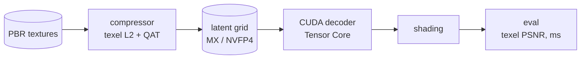

#### After

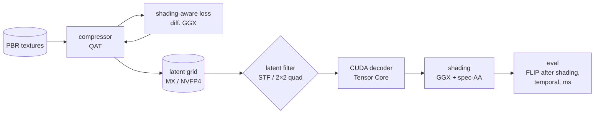

#### Example

```scenario
{"title": "Two weeks left after the milestone", "unit": "day", "illustrative": true,
 "lanes": ["compressor (2)", "decoder + renderer (2)", "paper / video"],
 "before": {"caption": "Proposal schedule: every format, baseline and stretch in parallel; paper starts last.", "result": "paper written in 2 days, no graphics contribution",
   "events": [{"lane": "compressor (2)", "from": 0, "to": 9, "text": "all formats + INT8 + shared decoder"},
              {"lane": "decoder + renderer (2)", "from": 0, "to": 14, "text": "Bistro + BC1 + stretch"},
              {"lane": "paper / video", "from": 14, "to": 16, "text": "write everything", "status": "bad"}]},
 "after": {"caption": "Lock the core by 11/29, spend week 3 on the graphics contribution and its eval.", "result": "paper drafted from 11/30, figures from eval runs",
   "events": [{"lane": "compressor (2)", "from": 0, "to": 7, "text": "all formats + BC1"},
              {"lane": "compressor (2)", "from": 7, "to": 12, "text": "shading-aware loss", "status": "good"},
              {"lane": "decoder + renderer (2)", "from": 0, "to": 7, "text": "Bistro end to end"},
              {"lane": "decoder + renderer (2)", "from": 7, "to": 12, "text": "STF latent filter + temporal eval", "status": "good"},
              {"lane": "paper / video", "from": 8, "to": 16, "text": "paper + video in parallel", "status": "good"}]}}
```

#### Decisions

- **Add shading-aware QAT as the main graphics contribution.** Quantization error in normals and roughness matters only through the BRDF, so training on GGX-shaded radiance under random light/view should spend bits where shading is sensitive; it lives in the PyTorch compressor and is cheap to add.
- **Filter in latent space with STF, and evaluate temporal stability.** Block-scaled latents can't use hardware filtering anyway; one stochastic tap per pixel keeps the decode cost at one MLP call and makes "flicker under motion vs bit width" a rendering result, not just a PSNR table.
- **Rejected: keeping texel PSNR as the headline metric.** Reviewers flagged it as an ML-compression result; report FLIP on shaded Bistro frames first, texel PSNR second.

#### Open

- [ ] Confirm no 2026 preprint already does shading-aware QAT for block-scaled NTC
- [ ] Decide the frame-time target (e.g. ≤ 16.7 ms) once the GPU is fixed

### 2026-11-20 · Lock contribution: shading-aware block-scaled quantization

> Main contribution is QAT on shaded radiance plus shading-aware block scales for MX/NVFP4 latents; latent STF is the supporting result. Paper skeleton set up as an Overleaf submodule.

#### Before

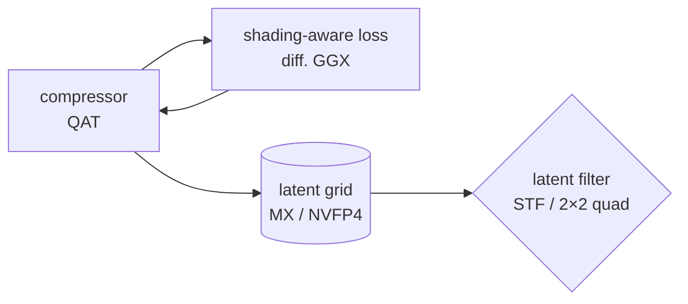

#### After

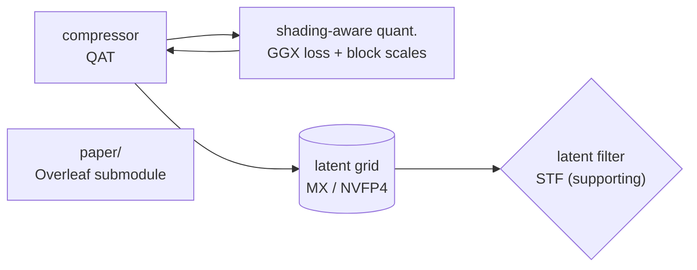

#### Decisions

- **Shading-aware quantization is the one claimed contribution.** It ties the quantization scheme to rendering: both the training loss and the per-block scale are judged by GGX-shaded error, so the paper reads as graphics, not ML compression.
- **STF latent filtering is supporting, not claimed.** It is needed anyway (hardware can't filter block-scaled values) and gives the temporal-stability figure.
- **Rejected: 2×2-quad decode as a contribution.** Stays a stretch goal until a literature check confirms novelty.

#### Open

- [ ] Ablation design: texel-L2 QAT / shading-loss QAT / shading-loss + shading-aware scales, same bytes per material

### 2026-11-20 · First compressor results: formats, shading loss, latent profile

> Compressor and 4 experiments run. Block-scaled formats share one quality-vs-bits frontier; the shading loss helps 15–23 % FLIP, but no more at 4 bits than at fp32.

#### Before

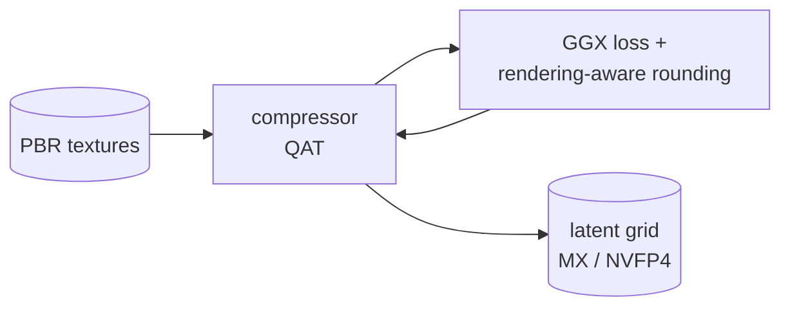

#### After

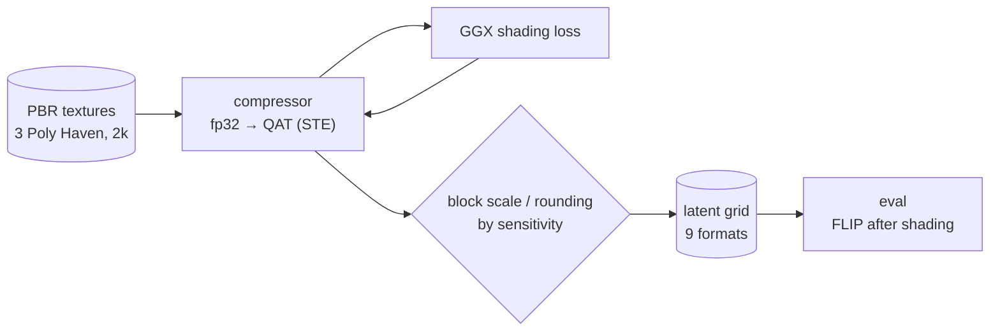

#### Decisions

- **The shading loss is a baseline, not the contribution.** Its FLIP gain is 23 % at fp32/fp16/MXFP8/MXFP6 and 15–17 % at 4 bits, so it is a general training improvement like prior appearance-driven work.
- **Novelty must come from quantization decisions made by rendered error.** Sensitivity spans ~3 decades and is uncorrelated with magnitude (r = 0.04), so max-abs and MSE rules cannot see it; a third of latents sit on a rounding boundary after QAT.
- **Rejected: grouped / vector codes over the 4-bit latents.** Measured entropy is 3.77–3.83 bits per 4-bit value and nearly every pair and quad occurs; LUT decoding stays an option for speed.

#### Results

| metric | value |
|---|---|
| FLIP, mid grid, MXFP4 vs fp32 (texel loss, 3 mat.) | 0.062 vs 0.046 |
| FLIP gain from shading loss, fp32 / MXFP4 | −23.1 % / −15.4 % |
| MX blocks with clipped max (castle_brick_07) | 27 % |
| latents within 1 % of a rounding boundary, before / after QAT | 4.4 % / 32 % |
| bits per 4-bit code, measured entropy | 3.83 |

#### Open

- [ ] Scale-selection and sensitivity-aware rounding results at 4 bits (texel- vs shading-weighted)
- [ ] Eval under unseen lighting; longer training for paper numbers (50k steps adds 0.4–0.9 dB)
- [ ] Remove stale uv files (`pyproject.toml`, `uv.lock`); pixi is the package manager

### 2026-11-21 · Paper plan: decoder-first, quantization as study

> Quantization gains are modest (3–10 % FLIP) and close to known methods, so the paper's main claim moves to decoding FP4 latents directly on Blackwell Tensor Cores.

#### Before

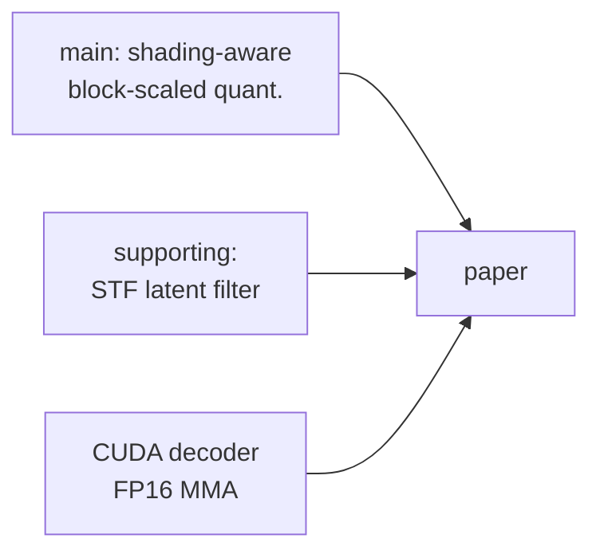

#### After

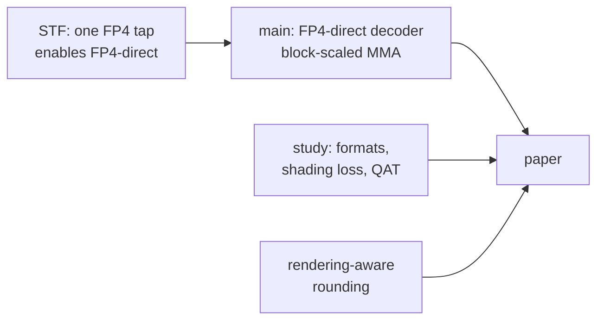

#### Decisions

- **Headline = decoder that feeds 4-bit block-scaled latents to the FP4 Tensor Core path.** Bilinear filtering mixes four taps into non-FP4 values; one STF tap keeps the stored codes and scale intact, so decode skips unpacking to FP16.
- **Quantization results become a "what matters" section.** Format barely changes quality per bit, the shading loss is general, a third of latents round near-randomly after QAT, scale selection hurts; rendering-aware rounding is one supporting technique.
- **Rejected: rendering-aware rounding as the main claim.** It is AdaRound with a rendering loss and gains 3–10 % FLIP; reviewers would call it incremental.

#### Paper outline (4–6 pages, acmtog)

| § | content | figure / table |
|---|---|---|
| 1 Intro | NTC meets block-scaled matrix hardware; 3 contributions | teaser: Bistro, FP4 materials |
| 2 Related | NTC, neural materials, block-compressed features, thread-efficient NTC decoding, MX/NVFP4, QAT + AdaRound, STF | — |
| 3 Formats | MX / NVFP4 recap; one NVFP4 block = one texel's 16 latents | block-to-texel layout |
| 4 Method | compressor + shading loss; STF tap → FP4 MMA fragments; rendering-aware rounding | decoder dataflow |
| 5 Results | format curves; shading loss + control; rounding (seeds, unseen light); decode µs/Mpix per format; Bistro ms; BC1/BC5 at equal memory | RD curves, rounding table, timing bars, crops |
| 6 Lessons | scale selection fails, QAT oscillation, what we'd change | — |
| 7 Conclusion | + per-member contributions (course rule) | — |

#### Open

- [ ] Literature check: does Thread-Efficient Decoding for NTC (2026) or the NTC SDK already decode FP4 latents with block-scaled MMA?
- [ ] Decoder for one material by ~11/25; Bistro wiring by ~11/29; timing + paper from 11/30

### 2026-11-21 · Decoder v1 and the FP4 MMA mapping

> First CUDA decoder matches PyTorch; blending latents before the MLP blocks FP4-direct decode and biases STF, so the model moves to 4 raw neighbours = one FP4 MMA.

#### Before

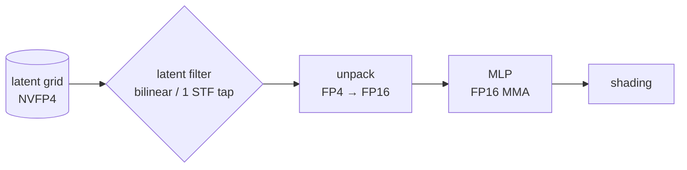

#### After

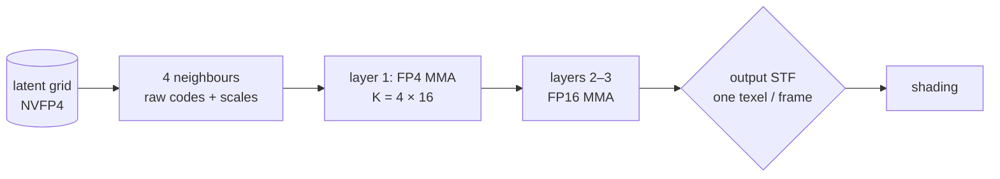

#### Decisions

- **Contribution statement: "the four neighbouring latent texels map onto the four scale blocks of one FP4 MMA."** A 16-channel texel is one NVFP4 block; four of them are the K = 64 operand and four block scales of `m16n8k64` block-scaled MMA, so stored codes reach the Tensor Core unpacked.
- **Filter in output space, not latent space.** One random latent tap decoded and averaged over 64 frames stays 20.6 dB from the bilinear decode, because the MLP is nonlinear; averaging decoded colors is exact.
- **Rejected: latent-space STF as the FP4-direct path.** It was the plan in the 11-20 entry; measured bias rules it out.

#### Results

| metric | value |
|---|---|
| kernel vs PyTorch, same taps (max / mean abs err) | 1.3e-3 / 1.0e-4 |
| 1080p frame, one lookup per pixel, v1 FP16 MMA | 0.83–1.16 ms (GPUs 95 % busy) |
| speedup vs PyTorch fp16 | 36–45× |
| latent-STF average vs bilinear decode, 64 frames | 20.6 dB |
| NVFP4 latents, castle_brick_07, mid grid | 2.95 MB (5.6 bits/texel) |

#### Open

- [ ] concat4 quality vs bilinear; if it loses, try wider layer 1 or more channels in grid 1
- [ ] v2 kernel timing on an idle GPU; Bistro wiring

### 2026-11-21 · Paper drafted: milestone report and full skeleton

> Milestone report written from `results/`; `main.tex` has intro through results study. Timing, Bistro and BC baseline stay as red `\todo`.

#### Before

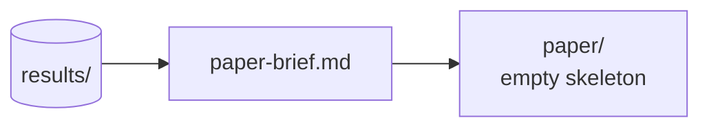

#### After

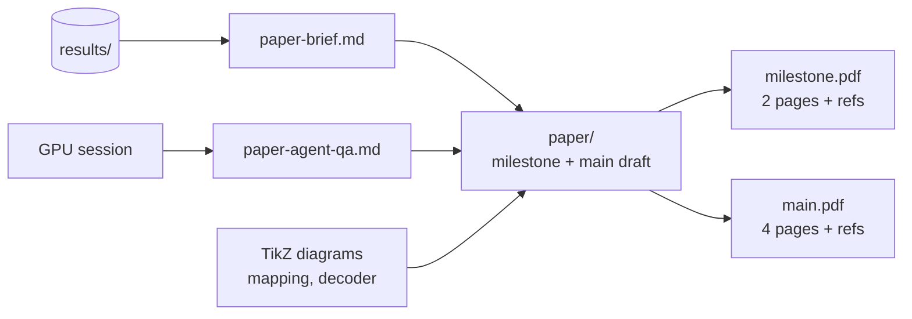

#### Decisions

- **Title now leads with C1: "Decoding FP4 Neural Textures Directly on Block-Scaled Tensor Cores".** The old title named shading-aware quantization, which the results demoted to a baseline.
- **Every number is recomputed from the CSVs and commented with its file; anything unmeasured is a red `\todo`.** Shading-loss gains use the `shade4` runs (fp32 −23.1 %, MXFP4 −15.4 %).
- **Diagrams are TikZ (black outlines, Helvetica), not images.** They stay editable in Overleaf and match the attached figure style.

#### Results

| metric | value |
|---|---|
| milestone.pdf | 2 pages + references |
| main.pdf | 4 pages + references |
| open `\todo` in main.tex | concat4 quality, v2 timing, Bistro, BC baseline, final rounding, teaser |

#### Open

- [ ] Push paper commit 61f56d6 to Overleaf after a team read
- [ ] Webpage, slides, video URLs in milestone
- [ ] `results/README.md` step 2 says −10 to −33 % FLIP; the CSV (`shade4`) gives −8.8 to −32.5 %. Paper uses the CSV
- [ ] Verify bib entries: Weinreich 2024, Fujieda & Harada 2024 title, Bistro, PTX ISA
