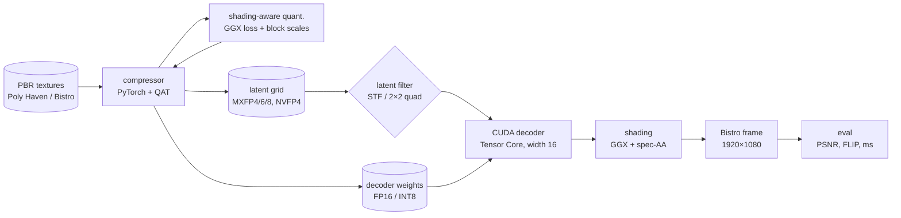
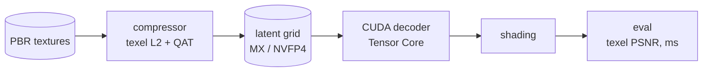
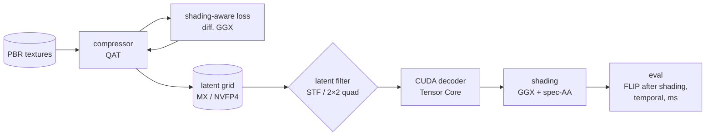
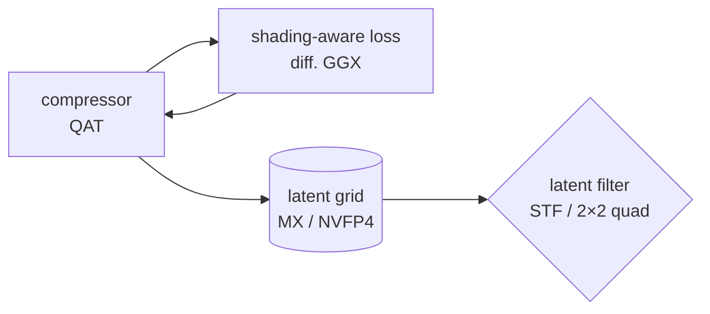
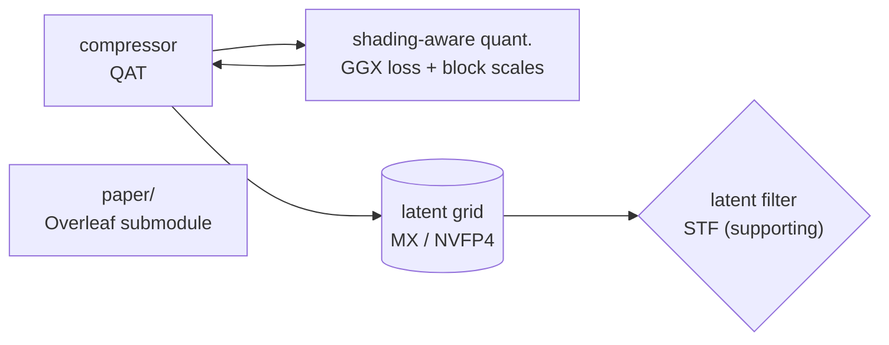

# Sixteen Wide — neural texture decoders for GPU matrix hardware

## Now

Proposal accepted with feedback "missing graphics novelty". Contribution is now **shading-aware block-scaled quantization** (main) with **latent-space stochastic filtering** (supporting). Paper skeleton is written; no code yet. Milestone is due **Sun 2026-11-22, 23:59 PT** (2 days); there are no late days.



| metric | target | now |
|---|---|---|
| Bistro frame time at 1920×1080 (ms) | real time (set number by milestone) | — |
| bytes per material vs BC1 | lower at equal PSNR | — |
| PSNR after shading vs uncompressed (dB) | report per format | — |
| FLIP after shading (mean) | lower with shading-aware loss than texel loss | — |
| decode time (µs per Mpixel) | report FP16 vs INT8 | — |
| formats working end to end | 5 (MXINT8, MXFP8, MXFP6, MXFP4, NVFP4) | 0 |

### Open

Course deliverables (team includes 284A, so all CS284A rules apply):

- [ ] **Milestone — Sun 11/22 23:59 PT** → Gradescope "[Final Project] Milestone": PDF in ACM SIGGRAPH template, with clickable links to webpage, slides and video
- [ ] Milestone report (paper format, ~1 page of content): what's done, preliminary results, progress vs plan, updated plan
- [ ] Milestone video: ~1 min, every member appears or speaks, unlisted YouTube or Berkeley-visible Drive
- [ ] Milestone slides: 2–3 slides, linked from the webpage
- [ ] Persistent project webpage (GitHub Pages) linking report, video, slides
- [ ] **Final — Sun 12/6 23:59 PT** → Gradescope "[Final Project] Final Deliverables": 4–6 page SIGGRAPH-format paper, focused on a novel technical contribution (40 % of the course grade)
- [ ] Final video: 1–2 min, every member appears or speaks (showcase uses only this)
- [ ] Final webpage: abstract, technical approach (incl. problems + lessons), results, references, per-member contributions, a showcase gif/clip
- [ ] Paper, video and slides must make clear: starting point (tiny-cuda-nn, NTC SDK, prior renderer) vs what we built
- [ ] **Presentation — Mon 12/7 or Tue 12/8**: 5 min hard (incl. 1 min demo) + 3 min Q&A; title slide marks each member 184/284
- [ ] Attend ≥ 8 other groups' talks (10 % of project grade); up to 20 for 5 % extra credit
- [ ] Peer review form, each member individually (date TBD on Ed; required to get a grade)
- [ ] Everyone commits under their own GitHub account (staff check contribution records)

Technical, by priority:

- [ ] P0 compressor: latent grid + MLP, fake-quant for uniform 8/4-bit, MXINT8, MXFP8, MXFP6, MXFP4, NVFP4; QAT with straight-through estimator
- [ ] P0 fit 3 Poly Haven materials, quality-vs-bits plot + side-by-side crops (milestone figure)
- [ ] P0 CUDA decoder for one material on Tensor Cores (FP16 MMA, width 16)
- [ ] P0 Bistro loads with original textures in the renderer
- [ ] P1 **contribution: shading-aware block-scaled quantization**: QAT whose loss is GGX-shaded radiance (random light/view), plus per-block scale choice that minimizes shading error instead of the MX spec's max-abs rule
- [ ] P1 ablation for the contribution: texel-L2 QAT vs shading-loss QAT vs shading-loss + shading-aware scales, per format, at equal memory (FLIP + PSNR after shading)
- [ ] P1 all Bistro materials compressed, decoder wired into renderer, per-pixel LOD
- [ ] P1 BC1 baseline at equal memory
- [ ] P1 **supporting: latent-space filtering with STF** + temporal stability vs bit width (flicker under camera motion)
- [ ] P2 INT8 decoder weights; shared decoder across materials
- [ ] P2 footprint-aware precision (fewer bits for coarse mips)
- [ ] P3 stretch: 2×2-quad decode per evaluation, auto bit allocation, second GPU, open benchmark
- [ ] Literature check before claiming novelty: Thread-Efficient Decoding for NTC (2026), NTC with Hypernetworks (2026), Fujieda & Harada 2024, Weinreich et al. 2024 (block-compressed neural features)
- [ ] Pick the exact GPU and write down its Tensor Core FP4/FP6 support
- [ ] Fix "Fuijeda and Harada 2024" citation (spelling, title, venue)

## Terms

- **NTC**: neural texture compression; a material's textures stored as a small learned latent grid plus a tiny MLP that decodes texels per pixel.
- **latent grid**: the learned feature table the decoder samples; what we quantize.
- **MX formats**: OCP microscaling formats; blocks of 32 values share one 8-bit power-of-two scale (MXINT8, MXFP8, MXFP6, MXFP4).
- **NVFP4**: NVIDIA's FP4 with 16-value blocks and an FP8 scale.
- **QAT**: quantization-aware training; the forward pass simulates rounding, gradients pass straight through.
- **shading-aware loss**: training loss computed on shaded radiance (GGX under random light/view) instead of on raw texel values.
- **shading-aware quant.**: the paper's contribution; shading-aware loss during QAT plus block scales chosen to minimize shading error.
- **paper/**: git submodule pointing at the team's Overleaf project (ACM SIGGRAPH `acmart` template).
- **STF**: stochastic texture filtering (Pharr et al. 2024); pick one texel tap per pixel at random with filter weights, decode once, let TAA average.
- **latent filter**: filtering done on the latent grid before decoding, since texture hardware cannot filter block-scaled values.
- **spec-AA**: specular anti-aliasing; widen roughness from the variance of filtered normals (Toksvig / LEAN) so quantized normals don't sparkle.
- **FLIP**: NVIDIA's perceptual image difference metric for rendered images.
- **BC1**: hardware block compression format; the memory/quality baseline.
- **Bistro**: Amazon Lumberyard Bistro scene, the full-scene test.

## Log

### 2026-11-20 · Plan: deliverables and graphics-novelty additions

> Mapped every CS284A deliverable to dates, and added a rendering-side contribution: shading-aware QAT plus latent-space stochastic filtering, judged on shaded frames and temporal stability.

#### Before



#### After



#### Example

```scenario
{"title": "Two weeks left after the milestone", "unit": "day", "illustrative": true,
 "lanes": ["compressor (2)", "decoder + renderer (2)", "paper / video"],
 "before": {"caption": "Proposal schedule: every format, baseline and stretch in parallel; paper starts last.", "result": "paper written in 2 days, no graphics contribution",
   "events": [{"lane": "compressor (2)", "from": 0, "to": 9, "text": "all formats + INT8 + shared decoder"},
              {"lane": "decoder + renderer (2)", "from": 0, "to": 14, "text": "Bistro + BC1 + stretch"},
              {"lane": "paper / video", "from": 14, "to": 16, "text": "write everything", "status": "bad"}]},
 "after": {"caption": "Lock the core by 11/29, spend week 3 on the graphics contribution and its eval.", "result": "paper drafted from 11/30, figures from eval runs",
   "events": [{"lane": "compressor (2)", "from": 0, "to": 7, "text": "all formats + BC1"},
              {"lane": "compressor (2)", "from": 7, "to": 12, "text": "shading-aware loss", "status": "good"},
              {"lane": "decoder + renderer (2)", "from": 0, "to": 7, "text": "Bistro end to end"},
              {"lane": "decoder + renderer (2)", "from": 7, "to": 12, "text": "STF latent filter + temporal eval", "status": "good"},
              {"lane": "paper / video", "from": 8, "to": 16, "text": "paper + video in parallel", "status": "good"}]}}
```

#### Decisions

- **Add shading-aware QAT as the main graphics contribution.** Quantization error in normals and roughness matters only through the BRDF, so training on GGX-shaded radiance under random light/view should spend bits where shading is sensitive; it lives in the PyTorch compressor and is cheap to add.
- **Filter in latent space with STF, and evaluate temporal stability.** Block-scaled latents can't use hardware filtering anyway; one stochastic tap per pixel keeps the decode cost at one MLP call and makes "flicker under motion vs bit width" a rendering result, not just a PSNR table.
- **Rejected: keeping texel PSNR as the headline metric.** Reviewers flagged it as an ML-compression result; report FLIP on shaded Bistro frames first, texel PSNR second.

#### Open

- [ ] Confirm no 2026 preprint already does shading-aware QAT for block-scaled NTC
- [ ] Decide the frame-time target (e.g. ≤ 16.7 ms) once the GPU is fixed

### 2026-11-20 · Lock contribution: shading-aware block-scaled quantization

> Main contribution is QAT on shaded radiance plus shading-aware block scales for MX/NVFP4 latents; latent STF is the supporting result. Paper skeleton set up as an Overleaf submodule.

#### Before



#### After



#### Decisions

- **Shading-aware quantization is the one claimed contribution.** It ties the quantization scheme to rendering: both the training loss and the per-block scale are judged by GGX-shaded error, so the paper reads as graphics, not ML compression.
- **STF latent filtering is supporting, not claimed.** It is needed anyway (hardware can't filter block-scaled values) and gives the temporal-stability figure.
- **Rejected: 2×2-quad decode as a contribution.** Stays a stretch goal until a literature check confirms novelty.

#### Open

- [ ] Ablation design: texel-L2 QAT / shading-loss QAT / shading-loss + shading-aware scales, same bytes per material
