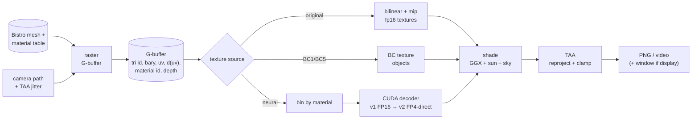

# Renderer spec: Bistro with neural textures

Status: draft, 2026-11-21. Written from the proposal (`docs/proposal/index.html`),
the project log, and the code as of `035b7e5`. Nothing here is built yet.
Items marked **(unverified)** are facts about Bistro or tools that I have not
checked; Stage 0 checks them.

## 1. What the renderer is for

The renderer exists to produce three numbers and one video, not to look good:

| output | used for |
|---|---|
| frame time breakdown at 1920×1080 (raster / bin / decode / shade / TAA, ms) | paper §5.5, headline timing |
| FLIP of each texture source against the uncompressed render | paper §5.1, §5.4 on a full scene |
| decode µs per Mpixel per latent format | paper §5.5 |
| fly-through video, split screen (original vs neural) | final video, presentation demo |

The proposal's wording for it: "a real-time renderer that uses [our system] on a
full scene", with "all textures compressed by our system", per-pixel level of
detail, filtering, and a Bistro frame time at 1920×1080. It names no graphics API,
shading model or lighting; those are decisions below.

## 2. Constraints that decide the architecture

1. **The decoder is CUDA only.** Block-scaled FP4 MMA (`m16n8k64`, `kind::mxf4nvf4`)
   is reached through PTX at `sm_120a` (`cuda/probe/`). It cannot live in a
   Vulkan/OpenGL shader, so the renderer is **deferred**: something produces a
   G-buffer, CUDA decodes and shades it.
2. **The decoder binds one material per launch.** `cuda/ntc_decode.cu` takes two
   grids and one weight set, and a warp decodes 16 pixels at once, so all 16 must
   share a material. Bistro has many materials, so pixels must be **binned by
   material** before decoding (§5).
3. **v1 is not a quality path.** v1 picks one latent tap per grid on a bilinear-trained
   model, which `results/decoder/` measured at 18–20.6 dB from the correct decode.
   v1 is good for plumbing and timing only. Quality numbers need the PyTorch model
   (`neural-ref`, D5) or the `concat4` model with the v2 kernel. `concat4` also
   grows layer 1's input from 40 to about 140 values, so v1 does not run it.
4. **Nothing exists to start from** (confirmed with the team). No renderer, no
   Bistro assets, no mesh loader.
5. **Output-space STF needs TAA.** Each pixel decodes one random texel per frame
   and TAA averages the colours, so the renderer needs a history buffer,
   reprojection and a jittered camera.
6. **The machine is headless and shared.** `bwrc-bwell` has two RTX PRO 6000
   Blackwell GPUs, no display, and both were 90–93 % busy when checked. EGL is
   present, `nvcc` is in the pixi env, Vulkan tools are not installed. Timing needs
   an idle GPU (§8).
7. **Time.** Two people on decoder + renderer, milestone tomorrow (11/22), final
   paper 12/6.

## 3. Architecture



The texture source is the only thing that changes between runs. Geometry,
G-buffer, shading and TAA are shared. FLIP is only comparable between sources that
use the same filter, so each comparison names its reference (D5).

## 4. Decisions

### D1. Rasterization: nvdiffrast over EGL, with a software fallback

- **Choice:** use `nvdiffrast` to rasterize Bistro into triangle id + barycentrics,
  with `rasterize_db` for uv derivatives. Everything after the G-buffer is our
  CUDA/PyTorch code. nvdiffrast is a starting-point dependency and must be named as
  such in the paper and webpage.
- **Why:** least code and no display needed. The G-buffer is already a CUDA
  tensor, so there is no interop to write.
- **Gate (Stage 0, ≤ 2 h):** build nvdiffrast in the pixi env and rasterize one
  triangle headless on a free GPU. **(unverified)** I believe it offers a CUDA-based
  rasterizer context as well as an OpenGL/EGL one; check which works here and what
  limits it has (resolution, triangle count). If neither works, fall back to a CUDA visibility-
  buffer rasterizer (64-bit `atomicMin` of depth|triangle id, then barycentrics in
  a resolve pass). That is about 300 lines and has no graphics-API dependency, but
  it is more work and slower on large triangles.
- **Rejected:** a standalone Vulkan/OpenGL app with CUDA interop. It needs a
  display, a window system and interop code, and none of that is the contribution.

### D2. Many materials: bin pixels by material, per-material decoders

- **Choice:** after the G-buffer, key-sort pixel indices by material id (CUB radix
  sort, carrying the original pixel index with each key because the kernel seeds
  its STF tap from the pixel index), build `(material, first, count)` work items
  padded to 16 pixels, and launch
  a decode kernel whose blocks each take one work item. A device-side material
  table holds each material's grid pointers, scales and weight fragments.
- **Why:** needs no change to the compressor, keeps v1 and v2 kernels
  interchangeable (same `uv + material → 9 channels` contract), and reuses the
  v1 kernel almost as is (it already takes grid and weight pointers).
- **Cost to measure:** the sort, padding waste at material boundaries, and
  re-loading 16 KB of weights per work item. Report decode time with and without
  binning cost.
- **Not the same as the proposal's "one shared decoder."** That is a research
  question (quality loss vs per-material decoders) and changes the compressor, so
  it stays a separate experiment (log: P2).

### D3. Lighting and shading: one sun, analytic sky, no shadows

- **Choice:** a per-pixel version of `sixteen/shading.py` (same GGX, same
  `AMBIENT`) with one directional light and the existing constant sky term, using
  a per-vertex tangent frame. If Bistro has no tangents **(unverified)**, derive
  them from uv derivatives per triangle.
- **Why:** the project's FLIP numbers are all computed with this model, so the
  renderer stays comparable with `results/`. Texture decoding is what is being
  tested, not lighting realism.
- **Known gap:** `shading.py` assumes a flat plane with the tangent-space normal as
  the shading normal, so the renderer is its first use on curved surfaces. Spec-AA
  (Toksvig) is listed in the log but not implemented; leave it out of Stage 1–3.
- **Optional, P2:** one shadow map for the sun. Skip unless time is left.

### D4. Filtering and LOD: stochastic first, neural mips later

- **Choice:** decode one full-resolution texel per pixel per frame, offset by a
  random point inside the pixel's uv footprint (from the G-buffer derivatives), and
  let TAA average. This is stochastic texture filtering done in output space.
- **Why:** it fits the C1 story (no latent blending, stored codes reach the MMA) and
  needs no mip chain of neural textures.
- **Risk:** large footprints (distant surfaces, grazing angles) give high variance,
  which shows as flicker. Measure it with the temporal-stability test (§7). If it is
  unacceptable, compress a few mip levels as separate neural textures (about +33 %
  memory, more training) for the far field only. That is the proposal's "level of
  detail per pixel" and is P1, not P0.

### D5. Texture sources behind one interface

| source | what it is | why |
|---|---|---|
| `original` | source images at fp16, trilinear mips | the milestone item (Bistro with original textures); frame-time floor |
| `original-stf` | the same images, decoded by the same footprint jitter and seeds as the neural path | **FLIP reference** for every neural source |
| `neural-ref/<fmt>` | PyTorch model on the G-buffer uvs, correct decode (about 42 ms per 1080p frame) | quality numbers while v2 is unfinished; correctness check for the kernels |
| `neural/<fmt>` | our CUDA decoder (v1 for plumbing and timing, v2 for the real thing) | the system under test |
| `bc` | block-compressed baseline; **which one is undecided, see below** | memory/quality comparison |

**Why two original sources.** Trilinear-then-shade is not the average of shaded
point samples, so comparing a converged STF render against `original` would measure
the filter, not the compression. FLIP for neural sources is always against
`original-stf`, accumulated over 64+ frames.

**Which model variant "compress all materials" trains** (bilinear or `concat4`)
depends on the `concat4` pilot. Its outputs (`out/concat4-pilot`) are not in this
checkout (`out/` is untracked), so I have not seen them. Decide before Stage 2
starts training.

**The BC baseline has two readings.**
1. The proposal's: store the *learned values* in BC1 "following Belcour and
   Benyoub", so texture hardware can filter them.
2. The log's: conventional BC1 (albedo) + BC5 (normal) + BC1 (ARM) at 16 bits/texel.

They answer different questions (our formats vs block compression of a neural
texture, vs vs conventional textures). **Team decision needed**; the spec assumes
(2) until told otherwise. Either way, **(unverified)** whether CUDA texture objects
on block-compressed `cudaArray`s are usable from our code (hardware filtering, fair
timing), and which encoder to use. Bistro's own textures may already be BCn DDS,
which would change what "original" means; Stage 0 checks this.

### D6. Demo: record first, live if a display turns up

- The team has a Blackwell GPU but no display path yet. **Plan on a pre-rendered
  split-screen fly-through** (original vs neural) recorded headless, with the live
  part of the demo being the benchmark script switching formats.
- Decide by **12/3** whether a live window is feasible (attach a monitor to the
  workstation card, or remote desktop with GL). Until then nothing in the renderer
  may depend on a window.

## 5. Interfaces

```text
G-buffer (per pixel, 1920×1080)
  tri_id int32, bary float2, uv float2, duv float4 (du/dx dv/dx du/dy dv/dy),
  material_id int16, depth float32, motion float2 (from depth + prev camera)

Material table (host-built, device-resident)
  per material: source image paths, uv scale, 9-channel layout flags,
  neural: {codes0, scales0, gscale0, w0, h0, codes1, ..., wfrag, bias}

decode(uv[N,2], pixel_id[N], material_id[N], frame) -> rgb9[N, 9]   # contract shared by v1 and v2
# pixel_id is the pre-sort pixel index: it seeds the STF tap, so sorting must not change it
```

The 9-channel layout stays as `sixteen/data.py` (albedo RGB sRGB-encoded, normal
XYZ, AO, roughness, metalness). Bistro's own packing **(unverified)** gets
converted into it once, at asset-prep time, not in the renderer.

## 6. Stages, dates and gates

| stage | when | what | done when |
|---|---|---|---|
| 0 | Sat 11/21 – Sun 11/22 | get Bistro; inventory (§9); nvdiffrast gate; if time, one albedo-textured frame | inventory written to `docs/bistro-inventory.md`; gate pass/fail recorded. **Do not let this displace milestone video, slides or webpage.** |
| 1 | 11/23 – 11/25 | `original` path: scene load, G-buffer, GGX shading, camera path, TAA, PNG/video out, per-stage ms | headless fly-through renders; frame time breakdown printed |
| 2 | 11/25 – 11/27 | compress all Bistro materials (variant chosen per D5); material table; binned decode with the **v1 kernel as a plumbing and timing check only**; `neural-ref` vs `original-stf` FLIP | one Bistro frame with every material neural; v1 output matches `neural-ref` on the same taps; FLIP number from `neural-ref` |
| 3 | 11/27 – 11/29 | output-space STF + footprint jitter; v2 FP4-direct kernel on the `concat4` model if ready; temporal-stability measurement | 64-frame accumulation of the CUDA path matches `neural-ref` (not v1) and approaches `original-stf`; flicker metric recorded |
| gate | **end of 11/27** | if Stage 2 is not met, switch the headline scene to FlightHelmet (the proposal's fallback), keep Bistro as original-texture teaser only | decision logged in `.claude/project-log.md` |
| 4 | 11/30 – 12/3 | timing per format on an idle GPU; BC baseline; fly-through video; display decision | numbers in `results/renderer/` |
| 5 | 12/1 – 12/6 | paper and video | — |

The renderer must not block on the v2 kernel: Stage 2 uses v1 and Stage 3 swaps
the kernel behind the same `decode` contract. If v2 is late, the paper's quality
numbers still exist (from `neural-ref`), but its timing claim does not.

**Training budget.** One fit at the large grid took about 8 minutes on a busy GPU
(`results/milestone/results.csv`, `train_s`). The material count is unknown until
Stage 0. Multiply it out before committing to "every material", and decide then
whether to cap texture resolution or fit at a smaller grid.

## 7. Measurements

- **Frame time:** CUDA events around bin, decode, shade, TAA, 200 frames after
  warm-up, median and p95, on a fixed camera path. Rasterization is timed
  separately: CUDA events if it runs through nvdiffrast's CUDA context, otherwise an
  OpenGL timer query (CUDA events do not see GL work). Report both and their sum.
- **Decode time:** µs per Mpixel, with and without binning, per latent format
  (FP4 / FP6 / FP8 / FP16 MMA).
- **Quality:** FLIP (and PSNR second) of `neural-ref/<fmt>`, `neural/<fmt>` and `bc`
  against the converged `original-stf` render, on fixed frames of the path.
- **Temporal stability:** mean absolute frame-to-frame difference after
  reprojection, per format and per source, on a path with camera motion. This is the
  "flicker vs bit width" result the log asks for.
- **Memory:** bytes per material and total texture memory per source.

## 8. Risks

| risk | effect | mitigation |
|---|---|---|
| both GPUs busy, so timings are not clean | headline numbers unusable | `bench` script records GPU utilization first and refuses to publish a timing above 5 %; agree a booking slot with whoever else is using the box |
| nvdiffrast does not build or run headless | Stage 1 slips a day | software rasterizer fallback (D1) |
| Bistro material count or texture size makes "compress everything" too slow | Stage 2 slips | cap resolution; compress a subset; FlightHelmet gate |
| STF flicker is visible at distance | weak temporal result | neural mip levels for the far field (D4) |
| alpha-tested foliage, emissive, glass **(unverified)** | does not fit the 9 channels | mark as `original`-only in the table and report coverage honestly |
| binning overhead eats the decode speedup | paper's timing claim weakens | report with and without; consider per-tile material lists |

## 9. Stage 0 inventory checklist

Fill in from the actual download, not from memory:

- [ ] source, licence, file format (FBX/OBJ/glTF), and which parts (exterior, interior)
- [ ] triangle and material count; unique texture count; texture resolutions
- [ ] texture file format (PNG or BCn DDS) and how maps are packed (base colour, normal, specular/ORM)
- [ ] tangents present? uv ranges and tiling (the decoder wraps)
- [ ] materials needing alpha test, emissive, transparency
- [ ] disk size, and where it lives (`data/` is gitignored)

## 10. Open questions for the team

1. Who owns the renderer vs the v2 kernel? The log's lane says "decoder + renderer (2)".
2. **BC baseline:** reading (1) or (2) in D5?
3. **Model variant** for "compress all materials": decided by the `concat4` pilot; who reads it?
4. Display path for the Blackwell box (monitor on the workstation card, or remote GL): decide by 12/3.
5. Is a recorded split-screen acceptable for the live-demo requirement?
