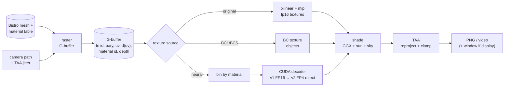

# Renderer spec: Bistro with neural textures

Status, 2026-11-21: **Stages 0 and 1 are implemented** on branch `renderer`
(`python/sixteen/render/`, `tools/render_bistro.py`, `tools/renderer_check.py`,
`python/tests/test_renderer.py`); results are in §11. Stages 2 onward (neural sources) are
not started. Written from the proposal (`docs/proposal/index.html`), the project log and the
code as of `035b7e5`. Items still marked **(unverified)** have not been checked;
facts that Stage 0 checked are folded into the text and `docs/bistro-inventory.md`.

## 1. What the renderer is for

The renderer exists to produce three numbers and one video, not to look good:

| output | used for |
|---|---|
| frame time breakdown at 1920×1080 (raster / bin / decode / shade / TAA, ms) | paper §5.5, headline timing |
| FLIP of each texture source against the uncompressed render | paper §5.1, §5.4 on a full scene |
| decode µs per Mpixel per latent format | paper §5.5 |
| fly-through video, split screen (original vs neural) | final video, presentation demo |

The proposal's wording for it: "a real-time renderer that uses [our system] on a
full scene", with "all textures compressed by our system", per-pixel level of
detail, filtering, and a Bistro frame time at 1920×1080. It names no graphics API,
shading model or lighting; those are decisions below.

## 2. Constraints that decide the architecture

1. **The decoder is CUDA only.** Block-scaled FP4 MMA (`m16n8k64`, `kind::mxf4nvf4`)
   is reached through PTX at `sm_120a` (`cuda/probe/`). It cannot live in a
   Vulkan/OpenGL shader, so the renderer is **deferred**: something produces a
   G-buffer, CUDA decodes and shades it.
2. **The decoder binds one material per launch.** `cuda/ntc_decode.cu` takes two
   grids and one weight set, and a warp decodes 16 pixels at once, so all 16 must
   share a material. Bistro has many materials, so pixels must be **binned by
   material** before decoding (§5).
3. **v1 is not a quality path.** v1 picks one latent tap per grid on a bilinear-trained
   model, which `results/decoder/` measured at 18–20.6 dB from the correct decode.
   v1 is good for plumbing and timing only. Quality numbers need the PyTorch model
   (`neural-ref`, D5) or the `concat4` model with the v2 kernel. `concat4` also
   grows layer 1's input from 40 to about 140 values, so v1 does not run it.
4. **Nothing existed to start from** (confirmed with the team): no renderer, no
   Bistro assets, no mesh loader. Starting-point dependencies we did not write:
   nvdiffrast (rasterizer), assimp/pyassimp (FBX import), Pillow (BC1/BC3/BC5 decode),
   NVIDIA's ORCA Bistro assets.
5. **Output-space STF needs TAA.** Each pixel decodes one random texel per frame
   and TAA averages the colours, so the renderer needs a history buffer,
   reprojection and a jittered camera.
6. **The machine is headless and shared.** `bwrc-bwell` has two RTX PRO 6000
   Blackwell GPUs, no display, and both were 74–95 % busy every time checked. `nvcc`
   comes with the pixi env. Timing needs an idle GPU (§8).
7. **Time.** Two people on decoder + renderer, milestone tomorrow (11/22), final
   paper 12/6.

## 3. Architecture



The texture source is the only thing that changes between runs. Geometry,
G-buffer, shading and TAA are shared. FLIP is only comparable between sources that
use the same filter, so each comparison names its reference (D5).

## 4. Decisions

### D1. Rasterization: nvdiffrast CUDA rasterizer (verified)

- **Choice:** use `nvdiffrast` to rasterize Bistro into triangle id + barycentrics,
  with `rasterize_db` for uv derivatives. Everything after the G-buffer is our
  CUDA/PyTorch code. nvdiffrast is a starting-point dependency and must be named as
  such in the paper and webpage.
- **Why:** least code and no display needed. The G-buffer is already a CUDA
  tensor, so there is no interop to write.
- **Gate: passed.** nvdiffrast v0.4.0 has `RasterizeCudaContext`, which needs no
  OpenGL, EGL or display. Built from the git tag (it is not on PyPI) with
  `no-build-isolation` and the CUDA dev libraries in `pixi.toml`. It rasterizes 1080p
  headless; a test triangle covered exactly the expected 1/8 of the screen with the
  expected uv derivatives. It handles Bistro's 1.0 M (interior) and 2.8 M (exterior)
  triangles at 4–14 ms per frame on a busy GPU. Its documentation states no resolution or
  triangle limit for the CUDA context; only 1920×1080 with up to 2.8 M triangles has been
  tried. The software-rasterizer fallback is not needed.
- **Rejected:** a standalone Vulkan/OpenGL app with CUDA interop. It needs a
  display, a window system and interop code, and none of that is the contribution.

### D2. Many materials: bin pixels by material, per-material decoders

- **Choice:** after the G-buffer, key-sort pixel indices by material id (CUB radix
  sort, carrying the original pixel index with each key because the kernel seeds
  its STF tap from the pixel index), build `(material, first, count)` work items
  padded to 16 pixels, and launch
  a decode kernel whose blocks each take one work item. A device-side material
  table holds each material's grid pointers, scales and weight fragments.
- **Why:** needs no change to the compressor, keeps v1 and v2 kernels
  interchangeable (same `uv + material → 9 channels` contract), and reuses the
  v1 kernel almost as is (it already takes grid and weight pointers).
- **Cost to measure:** the sort, padding waste at material boundaries, and
  re-loading 16 KB of weights per work item. Report decode time with and without
  binning cost.
- **Not the same as the proposal's "one shared decoder."** That is a research
  question (quality loss vs per-material decoders) and changes the compressor, so
  it stays a separate experiment (log: P2).

### D3. Lighting and shading: one sun, analytic sky, no shadows

- **Choice:** a per-pixel version of `sixteen/shading.py` (same GGX, same
  `AMBIENT`) with one directional light and the existing constant sky term, using
  a per-vertex tangent frame from assimp's tangent-space computation (not the FBX's own
  data), orthonormalized per pixel, with back faces flipped toward the viewer.
- **Why:** the project's FLIP numbers are all computed with this model, so the
  renderer stays comparable with `results/`. Texture decoding is what is being
  tested, not lighting realism.
- **Known gap:** `shading.py` assumes a flat plane with the tangent-space normal as
  the shading normal, so the renderer is its first use on curved surfaces. Spec-AA
  (Toksvig) is listed in the log but not implemented; leave it out of Stage 1–3.
- **Optional, P2:** one shadow map for the sun. Skip unless time is left.

### D4. Filtering and LOD: stochastic first, neural mips later

- **Choice:** decode one full-resolution texel per pixel per frame, chosen among the
  four nearest texels with bilinear weights (the same tap rule and hash as the CUDA
  decoder), and let TAA average. This is stochastic texture filtering done in output
  space. **No footprint offset is needed:** the camera is jittered every frame, which
  already integrates over the pixel; adding a footprint offset would blur twice. (An
  earlier draft of this spec had the offset; implementing it showed it is redundant.)
- **Why:** it fits the C1 story (no latent blending, stored codes reach the MMA) and
  needs no mip chain of neural textures.
- **Risk:** large footprints (distant surfaces, grazing angles) give high variance,
  which shows as flicker. Measure it with the temporal-stability test (§7). If it is
  unacceptable, compress a few mip levels as separate neural textures (about +33 %
  memory, more training) for the far field only. That is the proposal's "level of
  detail per pixel" and is P1, not P0.

### D5. Texture sources behind one interface

| source | what it is | why |
|---|---|---|
| `original` | source images at fp16, trilinear mips | the milestone item (Bistro with original textures); frame-time floor |
| `original-stf` | the same images, one stochastic bilinear tap per pixel per frame, same hash and seeds as the neural path and the CUDA decoder, camera jitter on | **FLIP reference** for every neural source |
| `neural-ref/<fmt>` | PyTorch model on the G-buffer uvs, correct decode (about 42 ms per 1080p frame) | quality numbers while v2 is unfinished; correctness check for the kernels |
| `neural/<fmt>` | our CUDA decoder (v1 for plumbing and timing, v2 for the real thing) | the system under test |
| `bc` | block-compressed baseline; **which one is undecided, see below** | memory/quality comparison |

**Why two original sources.** Trilinear-then-shade is not the average of shaded
point samples, so comparing a converged STF render against `original` would measure
the filter, not the compression. FLIP for neural sources is always against
`original-stf`, accumulated over many frames. Measured on the interior (§11), a
64-frame trilinear render sits at FLIP 0.0155 from a converged STF render, as large
as the STF noise of a 4–16 frame average. That gap also includes isotropic LOD selection and mips averaged
in sRGB space, so it is an upper bound on the effect of filter order alone; it shows the distinction matters,
not by how much.

**Which model variant "compress all materials" trains** (bilinear or `concat4`)
depends on the `concat4` pilot. Its outputs (`out/concat4-pilot`) are not in this
checkout (`out/` is untracked), so I have not seen them. Decide before Stage 2
starts training.

**The BC baseline has two readings.**
1. The proposal's: store the *learned values* in BC1 "following Belcour and
   Benyoub", so texture hardware can filter them.
2. The log's: conventional BC1 (albedo) + BC5 (normal) + BC1 (ARM) at 16 bits/texel.

They answer different questions (our formats vs block compression of a neural
texture, vs vs conventional textures). **Team decision needed**; the spec assumes
(2) until told otherwise.

**Stage 0 found that Bistro's own textures are already BC1/BC3 + BC5 + BC3** (see
`docs/bistro-inventory.md`). So reading (2) needs no encoder for Bistro: the shipped
textures are the baseline, at 12 bits per full-resolution texel for opaque materials
(the ARM maps are mostly 16²), and the "uncompressed original" does not exist. The
reference is the decoded BC data. Still **(unverified)**: whether CUDA texture
objects on block-compressed `cudaArray`s are usable from our code (hardware filtering,
fair timing for a BC frame time); the current `original` source decodes BC to fp16 on
load, so it is a quality reference, not a BC timing.

### D6. Demo: record first, live if a display turns up

- The team has a Blackwell GPU but no display path yet. **Plan on a pre-rendered
  split-screen fly-through** (original vs neural) recorded headless, with the live
  part of the demo being the benchmark script switching formats.
- Decide by **12/3** whether a live window is feasible (attach a monitor to the
  workstation card, or remote desktop with GL). Until then nothing in the renderer
  may depend on a window.

## 5. Interfaces

```text
G-buffer (per pixel, 1920×1080)
  tri_id int32, bary float2, uv float2, duv float4 (du/dx dv/dx du/dy dv/dy),
  material_id int16, depth float32, motion float2 (from depth + prev camera)

Material table (host-built, device-resident)
  per material: source image paths, uv scale, 9-channel layout flags,
  neural: {codes0, scales0, gscale0, w0, h0, codes1, ..., wfrag, bias}

decode(uv[N,2], pixel_id[N], material_id[N], frame) -> rgb9[N, 9]   # contract shared by v1 and v2
# pixel_id is the pre-sort pixel index: it seeds the STF tap, so sorting must not change it
```

The 9-channel layout stays as `sixteen/data.py` (albedo RGB sRGB-encoded, normal
XYZ, AO, roughness, metalness). Bistro's packing (BaseColor RGB + opacity alpha,
Specular R=AO G=roughness B=metalness, DirectX normals) is converted into it when the
textures are loaded (`render/textures.py`); alpha is carried separately and unused so
far.

## 6. Stages, dates and gates

| stage | when | what | done when |
|---|---|---|---|
| 0 | Sat 11/21 – Sun 11/22 | get Bistro; inventory (§9); nvdiffrast gate; if time, one albedo-textured frame | **DONE 11/21.** `docs/bistro-inventory.md`; gate passed (D1); textured frames in `results/renderer/`. |
| 1 | 11/23 – 11/25 | `original` path: scene load, G-buffer, GGX shading, camera path, TAA, PNG/video out, per-stage ms | **MOSTLY DONE 11/21** (§11). Still open: alpha/emissive, a real fly-through path (two-camera lerp only), video output, a better exterior camera. |
| 2 | 11/25 – 11/27 | compress all Bistro materials (variant chosen per D5); material table; binned decode with the **v1 kernel as a plumbing and timing check only**; `neural-ref` vs `original-stf` FLIP | one Bistro frame with every material neural; v1 output matches `neural-ref` on the same taps; FLIP number from `neural-ref` |
| 3 | 11/27 – 11/29 | output-space STF (done for the original source, §11); v2 FP4-direct kernel on the `concat4` model if ready; temporal-stability measurement | 64-frame accumulation of the CUDA path matches `neural-ref` (not v1) and approaches `original-stf`; flicker metric recorded |
| gate | **end of 11/27** | if Stage 2 is not met, switch the headline scene to FlightHelmet (the proposal's fallback), keep Bistro as original-texture teaser only | decision logged in `.claude/project-log.md` |
| 4 | 11/30 – 12/3 | timing per format on an idle GPU; BC baseline; fly-through video; display decision | numbers in `results/renderer/` |
| 5 | 12/1 – 12/6 | paper and video | — |

The renderer must not block on the v2 kernel: Stage 2 uses v1 and Stage 3 swaps
the kernel behind the same `decode` contract. If v2 is late, the paper's quality
numbers still exist (from `neural-ref`), but its timing claim does not.

**Training budget.** A mid-grid fit took a median 326 s on a busy GPU
(`results/milestone/results.csv`, `train_s`). Bistro has 64 (interior) and 121 (exterior)
materials with real 2048² detail (`docs/bistro-inventory.md`), so about 5.8 and 11
GPU-hours. Do the interior first. The remaining materials are near-constant and should
not be fitted as full-resolution neural textures.

## 7. Measurements

- **Frame time:** median and p95 over a fixed camera path after warm-up, per stage
  (raster, texture/decode, shade, TAA). Stage 1 times each stage as wall-clock with a
  device synchronize around it (`Renderer.render`), which includes Python launch
  overhead. The rasterizer is the CUDA context, so CUDA events would also work; switch to
  events when the neural kernels are timed.
- **Decode time:** µs per Mpixel, with and without binning, per latent format
  (FP4 / FP6 / FP8 / FP16 MMA).
- **Quality:** FLIP (and PSNR second) of `neural-ref/<fmt>`, `neural/<fmt>` and `bc`
  against the converged `original-stf` render, on fixed frames of the path.
- **Temporal stability:** mean absolute frame-to-frame difference after
  reprojection, per format and per source, on a path with camera motion. This is the
  "flicker vs bit width" result the log asks for.
- **Memory:** bytes per material and total texture memory per source.

## 8. Risks

| risk | effect | mitigation |
|---|---|---|
| both GPUs busy, so timings are not clean | headline numbers unusable | `bench` script records GPU utilization first and refuses to publish a timing above 5 %; agree a booking slot with whoever else is using the box |
| ~~nvdiffrast does not build or run headless~~ | resolved (D1) | — |
| Bistro material count or texture size makes "compress everything" too slow | Stage 2 slips | cap resolution; compress a subset; FlightHelmet gate |
| STF flicker is visible at distance | weak temporal result | neural mip levels for the far field (D4) |
| alpha-tested foliage, emissive, glass | does not fit the 9 channels: 4 interior / 12 exterior materials have real alpha (3.8 % / 10.1 % of triangles) | render as `original`-only and report the covered fraction honestly; currently drawn opaque |
| binning overhead eats the decode speedup | paper's timing claim weakens | report with and without; consider per-tile material lists |

## 9. Stage 0 inventory checklist

Done 2026-11-21; the answers are in `docs/bistro-inventory.md`:

- [x] source, licence, file format (FBX/OBJ/glTF), and which parts (exterior, interior)
- [x] triangle and material count; unique texture count; texture resolutions
- [x] texture file format (PNG or BCn DDS) and how maps are packed (base colour, normal, specular/ORM)
- [x] tangents present? uv ranges and tiling (the decoder wraps)
- [x] materials needing alpha test, emissive, transparency
- [x] disk size, and where it lives (`data/` is gitignored)

## 10. Open questions for the team

1. Who owns the renderer vs the v2 kernel? The log's lane says "decoder + renderer (2)".
2. **BC baseline:** reading (1) or (2) in D5?
3. **Model variant** for "compress all materials": decided by the `concat4` pilot; who reads it?
4. Display path for the Blackwell box (monitor on the workstation card, or remote GL): decide by 12/3.
5. Is a recorded split-screen acceptable for the live-demo requirement?

## 11. Status and results, 2026-11-21 (Stages 0 and 1)

> **Correction, 2026-11-22.** The specular map's "occlusion" channel is 0 in every Bistro map, and the
> first version of the renderer used it as ambient occlusion, so the ambient term was zero everywhere:
> the interior was dark for that reason, and `--ambient` had no effect. Fixed (an all-zero channel
> is treated as 1, in `render/textures.py` and `bistro_data.py`; test added). The preview frames,
> the stage-1 measurements and the neural comparison below were all regenerated after the fix.

**Implemented** (`python/sixteen/render/`): FBX import with tangents and uv re-basing
(`scene.py`), BC1/BC3/BC5 → fp16 mip pyramids and a packed `TextureAtlas` (`textures.py`),
`original` (trilinear) and `original-stf` sources, in a slow per-material reference form and a
vectorized atlas form (`sources.py`), nvdiffrast G-buffer with uv derivatives (`gbuffer.py`),
per-pixel GGX using `sixteen.shading.ggx_radiance` (`shade.py`), jittered accumulation and TAA
(`renderer.py`), and CLIs `tools/render_bistro.py` (PNG), `tools/renderer_check.py`
(measurements), `tools/bistro_inventory.py`.

**Verified** (`python/tests/test_renderer.py`, 15 tests, plus 6 existing and 3 that need a GPU decoder checkpoint; run with `pixi run test`):

| claim | how |
|---|---|
| uv, uv derivatives, material ids and jitter direction are right | synthetic two-quad scene with hand-computed values |
| shading equals `ggx_radiance` and is invariant to rotating the whole scene | identity-frame comparison; rotated geometry, light and eye |
| texture v axis points up; atlas lookup equals the per-material reference | gradient texture; random uvs, mips and tiling, both filter modes |
| mean of stochastic taps equals bilinear interpolation | 2048 frames at 512 points, max error < 0.03 |
| STF seeds equal the CUDA decoder's | compared with `decoder.pixel_seeds` |
| uv re-basing preserves uv mod 1 | integer-shift check |
| DirectX → OpenGL normal conversion (green flipped, z rebuilt) | unit test; and `tools/check_normal_convention.py`: after the flip, the normal's y agrees in sign with x against the albedo gradient in 42 of 48 textures (6 if unflipped). A visual A/B was inconclusive and is not evidence |
| Bistro interior has 1,046,609 triangles, 71 materials, all textures present | README count |
| TAA reprojection follows camera motion; with jitter it converges to the pixel mean | measured 2e-7 error on smooth signal; 0.011 vs 0.21 (jittered-hit variant) and 0.24 (one frame) |

The tests were mutation-checked (the texture conversion in `textures.py` was added to the tests afterwards and is covered by the normal test, not by this run): removing the v flip, flipping the bitangent handedness or
jitter sign, changing the STF hash, swapping trilinear weights, or scaling the normal each makes
a test fail. Writing the TAA test exposed a real bug (reprojecting the jittered hit blurred the
history); it is fixed and has a regression test.

**Measured** (`results/renderer/stage1_BistroInterior_entrance.json`; 1920×1080; both GPUs were
90 % / 89 % busy at the start, so timings are **not clean** and the p95 is wide):

| source | raster | texture | shade | total median (p95), ms |
|---|---|---|---|---|
| `original` (trilinear) | 2.7 | 10.2 | 2.4 | 18.8 (41.1) |
| `original-stf` | 2.9 | 4.1 | 2.4 | 16.0 (34.6) |

Stochastic path against a converged reference (256 frames; test frames are independent of it),
interior, static camera:

| | FLIP | PSNR dB |
|---|---|---|
| 1 frame | 0.0311 | 32.3 |
| 4 frames | 0.0165 | 39.8 |
| 16 frames | 0.0086 | 46.8 |
| 64 frames | 0.0047 | 52.9 |
| TAA, α = 0.1, 64 frames | 0.0119 | 42.4 |
| trilinear, 1 frame | 0.0225 | 34.4 |
| trilinear, 64 frames | 0.0156 | 41.2 |

The error falls about 6 dB per 4× frames, as unbiased noise should. TAA with the neighbourhood
clamp is worth roughly 8 averaged frames.

The committed preview JPEGs and the neural comparison use `--ambient 0.3` so the interior is visible; the
timing and convergence measurements above used the default 0.03 (`shading` in the JSON). Compare images only at one setting.

**What these numbers are not.** They say nothing about neural textures (see the next section). The frame times are for the original-texture path on a shared GPU, not the paper's
headline timing. Everything runs in PyTorch with per-stage synchronization; the shipping path
is the CUDA decoder.

**Known limitations of the current renderer:** opacity (cut-outs) and glass are drawn opaque;
emissive maps are ignored; no shadows, so interiors are dark under one sun (`--ambient` raises
the constant sky term for viewing, but comparisons must use one value); the exterior camera
preset sits under a canopy; only a two-camera lerp or a keyframe path exists; videos are written by `tools/bistro_videos.py`.

**Planned checks that have not run yet:** binned multi-material decode against unsorted decode;
any timing on an idle GPU; TAA under camera motion on
Bistro itself (it is only tested on a synthetic smooth signal).

Reproduce: `pixi run python tools/render_bistro.py --scene BistroInterior --ambient 0.3` and
`pixi run python tools/renderer_check.py` (first run imports the FBX, 25–90 s, then caches).
Download: `data/bistro-orca/` from `https://developer.nvidia.com/bistro` (see the inventory).

### Neural comparison (`tools/bistro_compare.py`, `tools/bistro_videos.py`)

Ten Bistro materials were fitted with the pilot config (`configs/bistro-pilot.yaml`: NVFP4 latents,
bilinear model, shading loss, 20000 steps) and decoded with the PyTorch decoder at texel centres
(`render/neural_ref.py`). They cover 91.3 % of the interior entrance frame's pixels; the rest keep the original textures.
Both frames use identical camera, jitter and tap seeds, so the difference is compression error only
(32 frames, ambient 0.3).

| | value |
|---|---|
| FLIP, whole frame | 0.0097 |
| FLIP, neural pixels only | 0.0046 |
| PSNR, whole frame / neural pixels | 54.1 / 53.7 dB |
| neural bytes, 10 materials | 28.3 MiB |
| BC bytes, same materials (top level / with mips) | 60.0 / 80.0 MiB |

Per material texel PSNR runs from 32.6 dB (`MASTER_Interior_01_Plaster`, noisy texture) to 63.2 dB (`Plates_Ceramic`); see
`results/renderer/neural-compare/neural_compare.json`. Videos in the same folder: `wipe_original_vs_neural.mp4`
and `neural_vs_decoder_v1.mp4` (120 frames, 1280×720, TAA). This section is the bilinear-model, PyTorch-decode run; the
decoder-v2 run below supersedes it as the headline.

**Caveats.** (1) This is the PyTorch decode of bilinear-model NVFP4 fits, not the CUDA kernel and not the
`concat4`/C1 configuration. (2) The reference is decoded BC data, so the claim is "FLIP X at Y× fewer bytes",
not "beats BC at equal memory"; BC bytes are counted for the same materials. (3) Decoder v1 (CUDA) taps in latent space
and is about 20 dB off the correct decode; the second video shows that. (4) Shared GPUs, so no timings here.

### Decoder v2 in the renderer (after merging main's v2, 2026-11-22)

`render/neural_ref.py` gained `MixedSourceV2`, which runs `CudaDecoderV2` (FP4-direct layer 1, output-space
stochastic filtering). The decoder's seeds come from the pixel's index in the batch, so each material's uvs are scattered
into a full-frame buffer and the whole frame is decoded per material (about 0.3 ms at 1080p); the seeds then equal the
screen pixel index and the taps match `AtlasSource(..., "stf")` exactly. Test:
`test_decoder_v2_source_uses_screen_pixel_seeds`. The same ten materials were refitted as concat4 with NVFP4
layer-1 weights (`configs/bistro-v2.yaml`, 20000 steps, shading loss; v2 needs this model). Outputs in
`results/renderer/neural-compare-v2/` (`tools/bistro_compare.py --fit out/bistro-v2`, `tools/bistro_videos.py`).

| interior entrance, 32 frames, ambient 0.3 | decoder v2 (concat4, NVFP4 weights) | bilinear fits, PyTorch decode |
|---|---|---|
| FLIP, neural pixels | 0.0064 | 0.0046 |
| FLIP, whole frame | 0.0140 | 0.0097 |
| PSNR, neural pixels | 51.5 dB | 53.7 dB |
| neural bytes, 10 materials | 28.4 MiB | 28.3 MiB |

* **The kernel is faithful.** The CUDA v2 render equals the PyTorch decode of the same fits to a max of 2.5e-04 (mean
  2e-05, 90 dB) in display values; the FP4 and FP16 layer-1 paths differ by at most 2e-04.
* **FP4-direct costs quality here.** concat4 with NVFP4 weights fits worse than the bilinear model in all 10 materials (flat-plane
  FLIP and texel PSNR), 38 % higher FLIP on the neural pixels, at the same latent bytes. The log's one-material
  pilot saw +12 %. Single seed per material, one view: do not quote the percentage. Neural bytes count the MLP at 16 bits, so v2 is slightly overcounted.
* **Decode time in the renderer** (10 launches per frame, GPUs shared and busy, not a headline number): 3.4 ms FP4,
  4.2 ms FP16 path. The headline numbers are Nicolas's idle-GPU ones in `results/decoder/`.
* **Videos**: `wipe_original_vs_v2.mp4` (original vs decoder v2) and `v1_vs_v2.mp4` (v1 on bilinear fits vs v2 on concat4 fits; they are
  different fits of the same materials).
